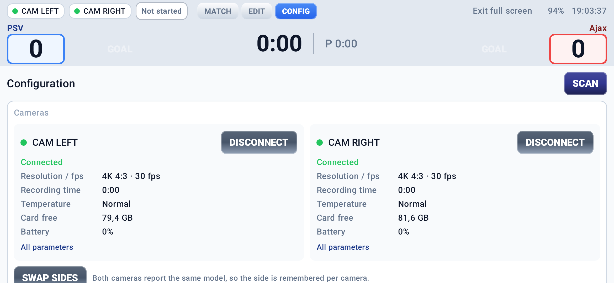
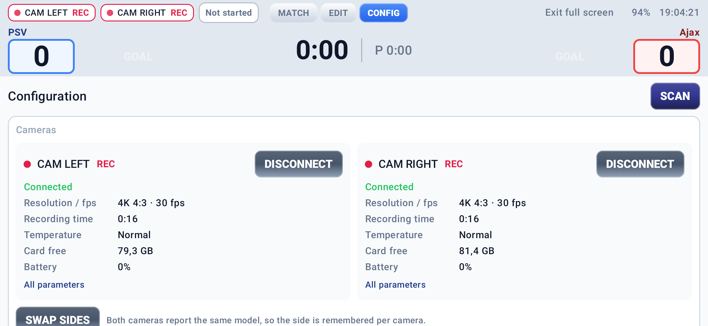
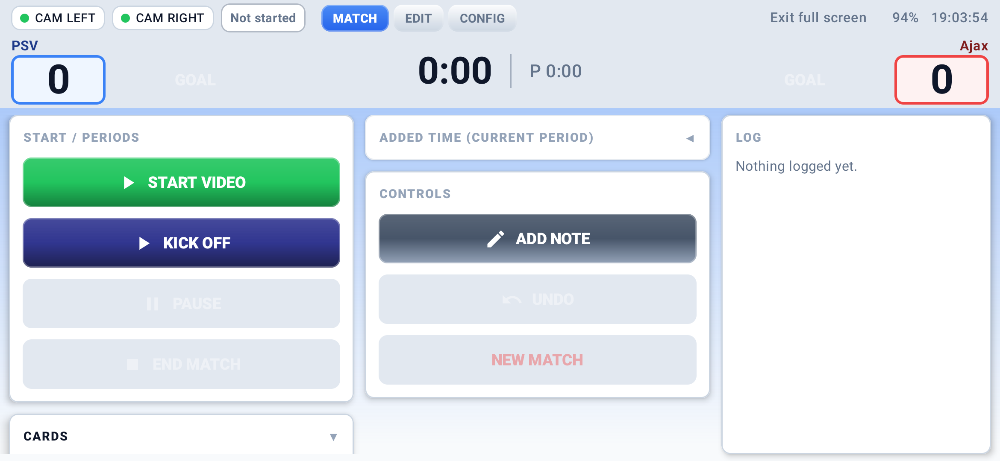
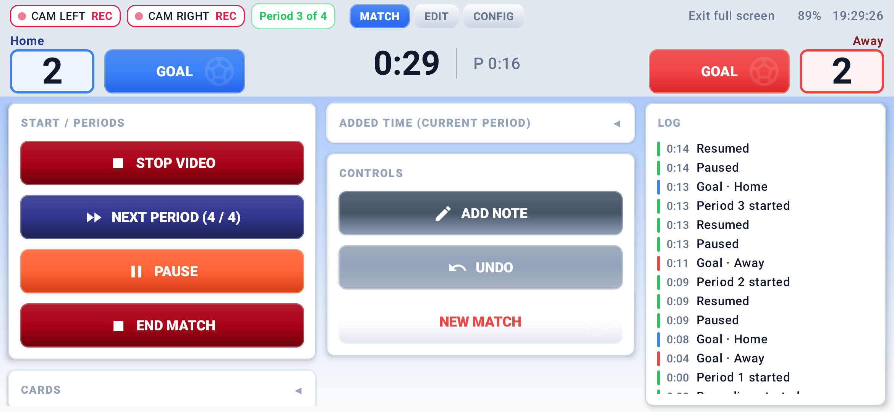
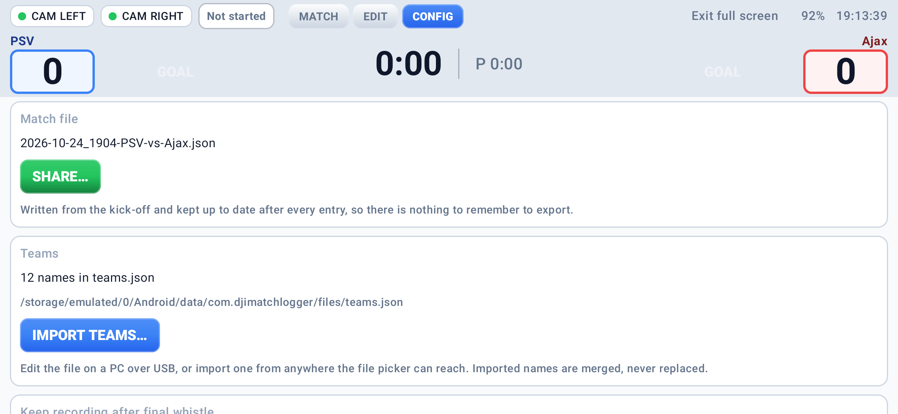

# DJI Match Logger — Android

An Android app for filming and logging a football match from the sideline.
It does two jobs at once: it keeps the **match log** (score, cards, periods,
added time, notes) and it **controls two DJI Osmo Action cameras** over
Bluetooth LE. Every logged event is saved with a match-clock time *and* a
time of day, so the log can be lined up with the camera footage afterwards.

The phone screen is bright enough to read outdoors in direct sunlight, which
is what the app was built for.

## How it works

### 1. Connect the cameras

Open the **CONFIG** tab and press **SCAN**. The app looks for DJI cameras
nearby and lists them; connect each one and give it a side, **CAM LEFT** or
**CAM RIGHT**. The first time, the camera shows a code that you confirm on
the camera itself. After that the app remembers the camera and its side, and
connects to it again by itself the next time it starts.

Both cameras are connected at the same time. Once connected, each shows its
resolution and frame rate, recording time, temperature, free card space and
battery — the things you want to know before the whistle. **SWAP SIDES**
exchanges left and right if you mounted them the other way round.

| Cameras connected | Cameras recording |
|---|---|
|  |  |

The pills at the top of every screen show the state of each camera at a
glance: green when connected, a flashing red **REC** while recording.

### 2. Set up the match

Press **EDIT** to pick the home and away team, the number of periods (four by
default) and whether yellow/red cards are tracked. Team names come from a
`teams.json` file, so you do not have to type them in at the pitch; see
[Files the app writes](#files-the-app-writes).

### 3. Record and play

On the **MATCH** tab, the left column starts and runs the match, the middle
column holds the extra controls, and the right column is the live log.

| Ready to start | During a match |
|---|---|
|  |  |

- **START VIDEO** starts recording on both cameras. You do this yourself,
  typically a few minutes before kick-off, so there is still time to deal
  with a camera that misbehaves. The app deliberately **never** starts the
  cameras on its own at kick-off.
- The app only treats a camera as recording once the camera itself confirms
  it. The moment it does, a *Recording started* event goes into the log, so
  the gap between recording start and kick-off is on record. A start the
  cameras never confirmed is marked *unconfirmed*.
- **KICK OFF** starts period 1 and the match clock. After that, **PAUSE** /
  **RESUME**, **NEXT PERIOD** and **END MATCH** drive the game clock.
- **GOAL** buttons sit next to each team's score. Yellow and red cards are in
  the collapsible **CARDS** panel, and extra minutes in **ADDED TIME**.
- **ADD NOTE** logs free text, and **UNDO** takes back the last action.
- After **END MATCH** the cameras keep rolling for a configurable delay
  (0–300 s, 30 s by default) so the handshakes and the post-match talk are
  filmed too. Undoing the end of the match cancels the countdown.
  **STOP VIDEO** stops both cameras straight away, after a confirmation.

### 4. Share the log

Every match is written to a JSON file at kick-off and updated after every
event, so there is nothing to remember to export. In the **CONFIG** tab,
**SHARE…** sends the file by e-mail, Quick Share or any other app.

Each event carries two times: `clock`, the match clock (what you write a
report with), and `time`, the time of day (what you match against the camera
footage, which knows nothing about periods or stoppages).



The same tab holds the team list (**IMPORT TEAMS…** merges names from a file
into `teams.json`), the post-match recording delay, and a switch between the
dark **Midnight** theme and the light **Daylight** theme.

## Features

- Match log: score, cards, periods, added time and notes, each with a
  match-clock time and a time of day
- Two cameras (CAM LEFT / CAM RIGHT) connected at the same time over BLE,
  remembered per camera and reconnected automatically
- Start/stop recording, confirmed from the cameras' own status pushes
- Live camera status: format, recording time, temperature, card space, battery
- Team names from a file; every match saved as JSON and shareable
- Landscape layout with big buttons, designed for use at the pitch side

## Build

Requirements: Android Studio (the bundled JBR is enough), an Android SDK
(set `sdk.dir` in `local.properties`), and the included Gradle wrapper.

```
./gradlew assembleDebug
./gradlew test
```

`minSdk 26`, `targetSdk 35`, `compileSdk 37`.

## Testing

The Android emulator has no Bluetooth radio, so anything involving the
cameras needs a physical device with USB debugging. UI work can be done in
Compose Previews (`ui/match/MatchPreviews.kt`) and the emulator.

### Tested on

So far the app has been tried on **one device only: a Nokia 7.2 running
Android 11 (API 30)**, with two DJI Osmo Action 4 cameras. That is an older
phone, and it sits on the old side of Android's Bluetooth permission change in
Android 12 (API 31).

- The Android 12+ permission path (`BLUETOOTH_SCAN` / `BLUETOOTH_CONNECT`) is
  implemented but **has not been tried on a real device**.
- `minSdk` is 26, but versions other than Android 11 are untested.
- Other DJI camera models are untested; the protocol notes in
  [`docs/ble-protocol.md`](docs/ble-protocol.md) are verified on the Osmo
  Action 4 only.

If you try it on another phone or camera, a report in the issues — working or
not — is very welcome.

## Files the app writes

| File | Where | What |
|---|---|---|
| `teams.json` | the app's external files directory | `{"teams":[...]}` — team names, editable by hand. A bare array is also read. Unreadable content is **not** overwritten. |
| `matches/<date>_<time>-<home>-vs-<away>.json` | `Documents/DJIMatchLogger` | The match log, opened at kick-off and rewritten after every change. |

## Forking

Forks are welcome under the licence below. Before you publish your own build:

- change `applicationId` / `namespace` in `app/build.gradle.kts` from
  `com.djimatchlogger`, so it does not clash with this app;
- create your own signing key (keystores are git-ignored);
- keep the licence and the notices in [`NOTICE`](NOTICE), and offer the source
  of your version to its users, as the AGPL requires.

Anything that talks to the cameras has to be tried on a real phone; see
[Testing](#testing).

## Documentation

- [`docs/ble-protocol.md`](docs/ble-protocol.md) — the camera BLE protocol,
  including behaviour that only shows up on real hardware
- [`CLAUDE.md`](CLAUDE.md) — design decisions and pitfalls for contributors
  (and for Claude Code)

## Acknowledgements

The camera protocol is not our work. Huge thanks to:

- **DJI** for publishing the official
  [`Osmo-GPS-Controller-Demo`](https://github.com/dji-sdk/Osmo-GPS-Controller-Demo),
  the reference this protocol is built on.
- **[rhoenschrat](https://github.com/rhoenschrat)** for
  [`DJI-Remote`](https://github.com/rhoenschrat/DJI-Remote), the open-source
  project that made the protocol approachable and was the starting point for
  talking to these cameras over BLE.

This project is not affiliated with or endorsed by DJI.

## Licence

Copyright (C) 2026 DuraS. Licensed under the
[GNU Affero General Public License v3.0 only](LICENSE) (AGPL-3.0-only).
Third-party notices are in [`NOTICE`](NOTICE).
